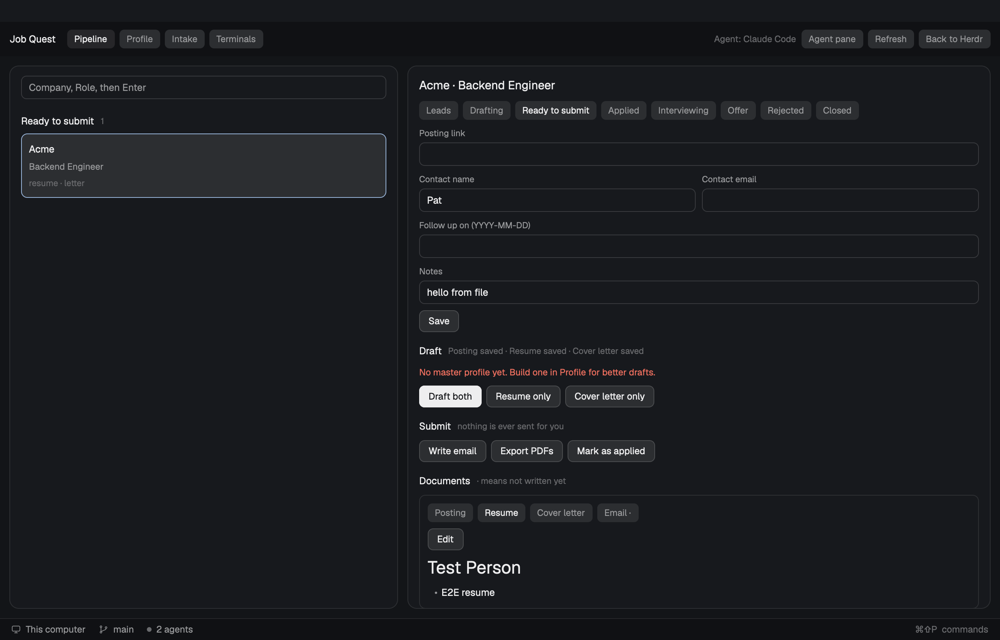

# Job Quest

A job-search workspace for the [Herdr](https://herdr.dev) desktop app. It is a **layout**, a whole window with a pipeline board, an application view and your coding agent side by side, filled by one **mod** that also works alone as a panel in your own layout. It tracks applications, has an agent draft tailored resumes and cover letters, and prepares application emails. Everything it knows is plain files in a folder on your computer.



## Install

Ask an agent inside Herdr:

> Read ~/.config/herdr-app/AGENTS.md, then add this layout: https://github.com/evanspn/job-quest

Or by hand:

1. Copy `mods/job-quest/` to `~/.config/herdr-app/mods/job-quest/`.
2. Copy `layouts/job-quest.json` and `layouts/job-quest.svg` to `~/.config/herdr-app/layouts/`.
3. Optionally merge `keys.json` into `~/.config/herdr-app/keys.json`: Ctrl+Shift+J switches to Job Quest.
4. Run `herdr-app check ~/.config/herdr-app/mods/job-quest`.

Then switch layouts with Ctrl+Shift+L, or `herdr-app do layout.switch --name job-quest`. **Back to Herdr** in the bar returns to your main layout.

**Before you install:** the mod runs programs (`gh` to list your repositories, your system's opener for folders and the mail app), starts coding agents in new tabs, and reads and writes files in its data folder. It makes no network requests of its own.

## The window

| Region | What it does |
| --- | --- |
| Bar | Switches between Pipeline, Profile, Intake and Terminals; shows or hides the agent pane. |
| Pipeline: board | Applications as cards in columns by stage. Type `Company, Role` and press Enter to add one. Follow-ups that are due are flagged. |
| Pipeline: application | The selected application: stage, posting link, contact, notes; Draft and Submit buttons; and its documents (posting, resume, cover letter, email), previewed and editable in place. |
| Profile | Your source material. Drop old resumes, cover letters or notes into the `profile` folder, paste a word dump, and choose which GitHub projects may be described. **Build master profile** turns it all into one document that drafts are tailored from. |
| Intake | What you are looking for: roles, level, work mode, locations, salary floor, stack, company stage, deal-breakers. Fill the form, or press **Interview me**. Also the data folder and which agent to use. |
| Terminals | Your normal Herdr tabs, including the agents Job Quest starts. |
| Agent pane | Opens on the right when a button starts an agent, showing it live so you can steer it. |

Buttons that need judgement (draft, write email, export PDFs, interview, build profile, summarize projects) start your coding agent in a new tab, in the data folder, with the task as its first message. The window re-reads the folder whenever a file changes.

### Keys and scripts

Besides `refresh`, `open-<id>`, `tab-<pipeline|profile|intake|terminals>` and `doc-<posting|resume|letter|email>`, the selected application takes `draft-both`, `draft-resume`, `draft-letter` and `write-email`. Bind them in `keys.json` (for example `"layout:job-quest": { "ctrl-shift-d": "job-quest.draft-both" }`) or run `herdr-app do job-quest.draft-both`.

The first time an agent starts in the data folder it may ask a question first (Claude Code asks whether to trust the folder). Job Quest shows the Terminals view so you can answer, then opens the agent pane.

### As a panel in your own layout

The same mod with no `part` is a tabbed panel. Open it as a window with `herdr-app do mod.open --name job-quest`, or add a block to your layout: `{ "type": "block", "content": { "mod": "job-quest" }, "size": { "px": 440 } }`.

## Where your data lives

In `~/job-quest-data` by default. Change it in Intake. Keep it inside your home folder. Nothing is stored in this repository.

```
job-quest-data/
  AGENTS.md  CLAUDE.md       what agents started here are told (written by the mod)
  intake.json                what you are looking for
  repos.json                 GitHub projects and whether each is included
  profile/                   your documents, notes.md, master.md
  guides/                    resume, cover letter and email guides
  applications/<id>/
    application.json         company, role, stage, contact, dates, notes
    posting.md  resume.md  cover-letter.md  email.md
```

The three guides are written on first run and are yours to edit. Drafts follow whatever they say. The resume guide covers modern software engineering resumes: one page, a single column that applicant tracking systems can read, impact-first bullets with real numbers, and tailoring to the posting.

## What it needs

- **A coding agent** Herdr knows how to start (Claude Code, Codex, ...).
- **The GitHub CLI** (`gh`, signed in) to import your repositories. Without it, add repositories by address.

The mod never sends email and never submits an application. Drafting tasks tell the agent to use only what your files say and to report gaps to you.

## Developing

```
npm test
```

runs the data rules and the mod's logic against stand-ins for Herdr's modules. It does not prove the UI draws: for that, install as above, run `herdr-app check`, and look at it in the app. `.claude/skills/` holds notes for agents working on this repo, including the patterns taken from three gallery entries (Kanban, Spec Board, Over9k). `RECIPE.md` is the brief to rebuild it from scratch.
