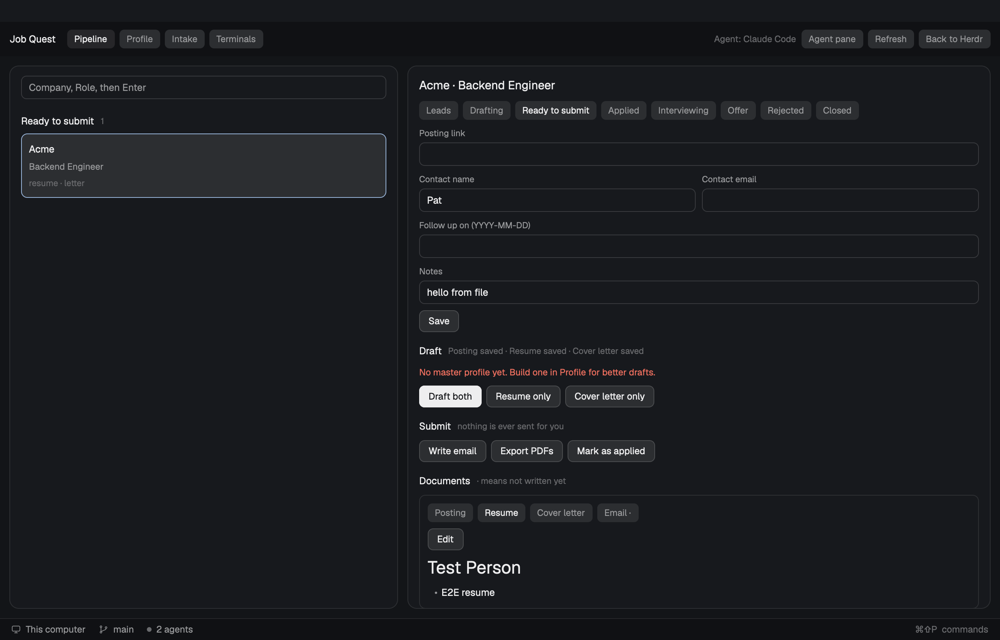

# Job Quest

A whole window for a software job search. A board of applications by stage sits beside the selected application and, when one is working, your coding agent. Other views hold your profile and what you are looking for. All data is plain files in a local folder, and the same mod works alone as a tabbed panel.

## What you see

- **Bar** (44 px, `chrome`): "Job Quest" semibold; chips Pipeline, Party, Profile, Intake, Terminals (24 px, the shown view on `selected`); at the right the party's count ("2 questing · 1 need you · 1 to approve", `blocked` when anything needs the person; click: Party), an Autopilot chip, the chosen agent's name, "Starting agent…" in `working` while one starts, and chips Agent pane, Refresh, Back to Herdr.
- **Body** (12 px padding, 12 px gaps): cards on `surface` with a 1 px `border` and 12 px radius.
- **Pipeline: board** (left, fills): a New application field, a `blocked` line for follow-ups due, then columns 210 px wide, one per stage, scrolling sideways. Leads to Offer always show; Rejected and Closed only when used. Each column has a semibold heading with a count and cards (8 px radius, `background`; the selected one `selected` with an `accent` border): company, role in `muted`, which documents exist, and the follow-up date (`blocked` when due). Under 700 px wide the columns become groups one above another, empty ones hidden.
- **Pipeline: application** (right; shares the row with the board 3:2, 320 to 760 px): the name at 15 px; stage chips; applied and follow-up dates in `done`; fields for posting link, contact name and email side by side, follow-up date, notes; Save. A Draft heading with what exists, then Draft both (solid), Resume only, Cover letter only. A Submit heading, then Write email, Open in mail app (once an email exists), Export PDFs, Mark as applied. A Documents card with chips Posting, Resume, Cover letter, Email (a `·` marks one not written), an Edit button and the markdown; editing shows Save, Cancel and a 420 px editor.
- **Profile:** files in `profile/`, Open profile folder; a word dump area with Add to notes; the master profile's state with Build or Update; GitHub projects with Import from GitHub, Summarize included (n), an add field, and a row per repository (checkbox, name, `private` / `summarized`).
- **Intake:** ten labelled fields (the last: the score a lead needs for the party to take it on), Save, Interview me; the data folder with Open folder and Change; a chip per installed agent.
- **Terminals:** a 40 px strip of tabs, one per live terminal whose folder is the data folder, oldest first: state mark, the tab's name (`<glyph> <member>/<application id or scout date>`), × to close; the shown one `selected` with an `accent` border, one that needs the person with a `blocked` border. Below, an agent block shows the chosen one full size. Opening the view hides the agent pane and shows Job Quest's newest agent if another was focused.
- **Party:** "⚔ The Party" at 17 px with an Autopilot chip and 🏹 Send the Scout; one line on how it works; Awaiting your approval (a card per Ready application: name, fit, review verdict, Review (solid) and Open email); The roster (a 236 px card per member: a 42 px round glyph in the member's theme color that pulses while working, name, role, up to three job lines, "n done today"; the border `blocked` when one needs the person); Adventure log (the newest 40 lines, local time and text).
- **Chat** (right of the views, 380 px, shown): "💬 Party chat" and how many are at work; the feed, scrolled to the newest: events as one dim centered line, a worker's message as a 26 px glyph, name, application, time, Reply and Watch, and the text on `raised`; yours right-aligned on `selected` with "You → <who>"; then, while an `@` is being typed, a list of `@everyone` and each running worker's handle with what it is doing (click to insert), the message field, and a line saying who it goes to (no mention: everyone running).
- **Agent pane** (right, 520 px, hidden at first): the focused agent's terminal.
- **Rail** (far right, 78 px): ⚔ (click: Party), AUTO / PAUSED (click: switch), a rule, then a tile per job on screen: a 44 px glyph tile with a 2 px border in the member's color (`blocked` when it needs the person, `accent` when shown; the shown one squarer, on `selected`, with a white bar on its left), a spinner, pulse, ✓ or ✕ and the member's name under it, and the company. Finished ones at half opacity. A round 🏹 at the bottom sends the Scout.
- **Board cards** also show a lead's fit as a rarity (Common, Rare 65+, Epic 80+, Legendary 90+) and the job working on it. **The application** shows a party card under the stage chips: the job on it (Watch, Close its tab), Send the party for a lead, the next member and Start … now, or why it is stuck. Its Documents card adds Research, Review, Follow-up and Interview prep.
- **Status bar:** Herdr's own.
- **Errors:** a line in `ansi1` at the top of the part that failed, with Dismiss.

## How it behaves

- Type `Company, Role` and Enter: a new card in Leads, selected. A taken id gets `-2`, `-3`.
- Click a card: the application view follows, in the layout through shared state, in the panel by switching tab.
- Enter in any text field saves every text field. A field the person has not touched follows its file when the file changes; one they are typing in is left alone.
- A stage chip sets the stage. The first move to Applied stamps today and a follow-up seven days out.
- Save posting: a bare link is stored as the application's `url`; anything else becomes `posting.md`.
- Draft, Write email, Export PDFs, Interview me, Build master profile and Summarize included start the chosen agent in a new tab in the data folder. Drafting from a lead moves it to Drafting. Write email and Export PDFs refuse until a resume exists. In the layout, the agent pane opens on the new agent within a second or two. A program still asking a first-run question (Claude Code's folder trust, its MCP prompt) is not an agent yet: after three seconds `terminal.peek` opens it over the window so the person can answer, and once it reports a status it is shown (in Terminals if open, else the agent pane). Every copy's bar says "Starting agent…" meanwhile.
- Edit, change, Save writes the document only if the file is still what was opened. If an agent wrote meanwhile, an error says so and the text stays in the editor.
- Import from GitHub runs `gh repo list` and adds repositories it does not have, left out. A row click toggles inclusion.
- Open in mail app turns `email.md` into a `mailto:` address for the system opener.
- **The party.** The rail's copy (or the panel's) runs a round every 3 s while it holds a lease in shared state. A round matches each job to its agent by tab name, sets its state from the agent's status and whether its file exists, closes finished automatic tabs 90 s later unless shown, then (autopilot on) starts today's Scout if `reports/scout-<today>.md` is missing, moves leads scoring at least the Intake threshold to Party at work, moves finished applications to Ready (toast and the done sound), and starts the next member for each application in Party at work, Applied with a follow-up due, or Interviewing: at most three live jobs, one per application, each key once. Automatic jobs open in the "Job Quest party" space; button jobs where the person is. Every event is a line in `log.jsonl`.
- Click a rail tile, a job line, or Watch: `agent.focus` on that agent and show the agent pane; on the one already shown, hide it. `party-next` / `party-prev` cycle.
- The folder is watched; any change re-reads it. After its own save a copy also bumps a shared revision so the other copies reload.

## Built from

- **Layout** `layouts/job-quest.json`: `column root` of `jq-bar` (block, 44 px), `jq-body` (row) and `jq-status` (block `workspace-status`, 28 px). `jq-body` holds `jq-view` (a stack: `jq-pipeline` = row of `jq-board` (weight 2, min 240) and `jq-detail` (weight 3, min 320, max 760); `jq-profile`; `jq-intake`; `jq-terminals` = column of `jq-term-tabs` (part `tabs`, 40 px) and `jq-term-view` (`{ "agent": "focused" }`), with `jq-party` after `jq-pipeline`), `jq-agent` (`{ "agent": "focused" }`, 520 px, hidden) and `jq-rail` (78 px). System title bar. Preview `layouts/job-quest.svg`.
- **Mod** `mods/job-quest`, `mod.json` `{ "place": "none", "title": "Job Quest", "overlay": { "width": 620, "height": 780 } }`. `props.part` is `bar`, `board`, `detail`, `party`, `profile`, `intake`, `rail`, `tabs` or `chat`; none is the tabbed panel.
  - `main.js` state and actions; `views.js` drawing; `ui.js` shared pieces; `model.js` shapes and rules; `store.js` the folder; `prompts.js` agent tasks and the data folder's `AGENTS.md`; `party.js` the leader's round; `party-views.js` the rail and Party view; `guides.js` the three guides.
- **Shared keys:** `job-quest.selected`, `job-quest.revision`, `job-quest.dir`, `job-quest.agent`, `job-quest.starting` (when a copy started an agent it still waits for; 0 when none), `job-quest.party` (the jobs), `job-quest.leader` (the lease), `job-quest.autopilot`, `job-quest.shown`.
- **`herdr`:** `run` (`tab.new`, `space.new`, `space.select`, `tab.rename`, `tab.close`, `layout.hide`, `layout.select`, `layout.show`, `layout.toggle`, `layout.switch`, `agent.focus`), `exec`, `theme`, `notify`, `knownAgents`, `agents`, `terminals`, `pickFolder`, `shared`, `setShared`, `watchFolder`, `window`, `layout`, `settings`, `spaces`, `playSound`, `props`, `nextCommand`, `home`, `readTextFile`, `writeTextFile`. `gpui-base`: `InputState`/`Input`, `TextareaState`/`Textarea`, `EditorState`/`Editor`, `TextView`. `fs/promises` `readdir`.
- **Programs:** `gh`; `open` / `xdg-open` / `cmd /c start`.
- **Commands** (`nextCommand`): `refresh`, `open-<id>`, `tab-<name>`, `doc-<posting|resume|letter|email>`, and for the selected application `draft-both`, `draft-resume`, `draft-letter`, `write-email`. Every shown copy receives a command; only the copy that draws the application (`detail`, or the panel) acts on the four agent commands, so one agent starts.
- **Keys:** `ctrl-shift-j` to `layout.switch:job-quest`.
- **Modelled on** three gallery entries: Kanban (one mod in several blocks by `props.part`, a view stack, an agent block), Spec Board (files as the database, list and detail, edit in place, test commands), Over9k (a layout whose mod also stands alone, agents taught by `AGENTS.md`).

## Watch out

- Each block is a separate copy of the mod. Nothing on the instance is shared; use `shared()`.
- Create `InputState`s after a load or a selection, never while rendering.
- `writeTextFile` rejects unless `expected` is exactly what the file holds: read first, one edit at a time, and treat a rejection on a document as a conflict.
- `fs.readdir` reads only inside the home folder: a data folder elsewhere lists as empty.
- `run()` returns nothing. The started program is found by comparing `terminals()` before and after; `agents()` lists it only once it reports a status, which a first-run prompt delays.
- Implicit pane commands fail while a layout terminal or agent block has focus; this mod sends none.
- An agent may write malformed JSON. Every reader coerces and never throws.
- A `mailto:` body is limited by the mail app; `email.md` is the full text.
- Every block starts at once on first open, so the first-run writes race; a write rejected because another copy already wrote the same text is not an error.
- Checked with `herdr-app check` and seen in Herdr 0.1.15: bar, board, application view, Profile, Intake and Terminals draw; a card follows files an agent writes. Click-driven flows (Draft, edit and save) still need a person to try them.

## Done when

- `herdr-app check ~/.config/herdr-app/mods/job-quest` passes, and `npm test` passes.
- `herdr-app do layout.switch --name job-quest` shows the bar, the board and an empty application view.
- Adding `Acme, Backend Engineer` puts a card in Leads and fills the application view.
- The Profile chip in the bar swaps the body; Terminals shows the active tab.
- Draft both (or `herdr-app do job-quest.draft-both`) opens a new tab running the agent in the data folder, the card moves to Drafting, and the agent pane opens on it; a first-run question shows in Terminals first.
- After the agent writes `resume.md`, the card shows `resume` and the Resume document previews, without Refresh.
- Editing the resume and saving changes the file; saving after the file changed underneath reports a conflict and keeps the typed text.
- `herdr-app do job-quest.open-acme-backend-engineer` selects that application.
